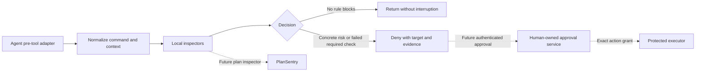

# NoMeatProxy design

Status: initial design and working prototype, 2026-10-09.

## Product contract

NoMeatProxy lets a coding agent work autonomously while escalating specific
operations with serious, hard-to-reverse consequences. The human should see
what would be affected and why it matters.

The first supported environment is a developer's POSIX shell and Git worktree.
Windows/PowerShell, remote tool execution, deployment providers, and native
editor tools require separate inspectors and compatibility work.

Three questions guide every inspector:

1. What concrete target will the action affect?
2. What valuable state could be lost or exposed?
3. What evidence establishes a recovery path?

A name such as `test`, `cache`, or `dist` is not proof that a resource is
disposable. Likewise, being inside a repository does not mean a file is backed
up by Git. Explicit human-owned disposable-resource policy is a planned way to
allow common cleanup without weakening protection elsewhere.

## Architecture

The current implementation ends at pass/deny. Neither a protected executor nor
an approval service exists yet.

### Adapter contract

Normalize the pending command, actual execution directory, and a stable
workspace boundary into `CheckRequest`. A tool-specific `workdir` changes the
execution directory, not the workspace boundary.

The result contains:

- `decision`: `pass` or `deny`.
- `findings`: stable rule IDs, consequence, targets, evidence, and next step.
- `limitations`: effects the engine did not inspect.
- `elapsedMs`: policy-engine time, excluding process and host-adapter startup.

Hooks are silent on pass. They never return an affirmative permission grant
that could override another policy. A denial must happen before execution.
Malformed shell-hook input produces a denial rather than an optimistic pass.

`check --json` surfaces coverage gaps. The initial hook does not persist a
command log or emit a warning on every unrecognized command. A future coverage
summary should make gaps visible without adding per-call noise or storing
secrets from shell arguments.

### Inspectors

Keep deterministic rules in-process. Start read-only probes only when the
action warrants them; never execute the submitted command to discover its
effects. The Git helper uses constructed argument arrays, no shell, no network,
disabled hooks and fsmonitor, a time limit, and an output cap.

The current checks protect selected paths, identify work not preserved in Git,
preview forced Git cleanup, and hold remote history rewrites. Restore and
explicit-path checkout inspections use Git's pathspec semantics and distinguish
index content from worktree content. Unstaging can proceed when the worktree
retains the staged version; it is held when a distinct staged version could be
lost. Hard reset and forced branch switching still check the entire worktree.

Shell inspection must preserve quoting and distinguish literal text from
expansion. Known destructive actions with unresolved targets are held.
Unrecognized execution mechanisms are a documented coverage gap; the prototype
does not claim to infer arbitrary program behavior.

### PlanSentry integration

PlanSentry should remain an independent infrastructure inspector. The proposed
adapter asks it for structured findings and a reference to a checked artifact.
Approval and execution must bind to the exact artifact, target account,
workspace, and relevant execution options. Re-planning after approval invalidates
the grant.

Do not transplant a generic `--ack DIGEST` escape hatch into the new design.
A digest identifies bytes or an action; it does not establish who approved it.
The exact shared API and artifact-binding implementation need separate review.

## Decisions and failure behavior

| Situation | Prototype behavior |
| --- | --- |
| Routine recognized command | Pass without a subprocess |
| Protected target or known destructive remote mutation | Deny with evidence |
| Risky Git operation with a successful clean-state check | Pass |
| Required Git probe times out or exceeds output/budget limits | Deny |
| Malformed shell syntax or hook payload | Deny |
| Unrecognized executable or effects inside a script | Pass; expose a limitation in inspection output |
| Host fails to start or honor the hook | Outside the engine's control |

Passing unsupported code is a deliberate boundary of this initial accident
guard. A future stricter mode may require a broker for opaque execution, but
quietly implying full protection would be misleading.

## Human approval

The prototype has no self-approval command. A blocked intentional operation is
reviewed and performed by a human outside the agent.

The future approval service should:

1. Present evidence and consequences through a human-owned interface.
2. Mint a single-use, expiring grant bound to command/artifact bytes, resolved
   targets, workspace, and relevant environment/credential context.
3. Reject changed artifacts or target identity and require a fresh review.
4. Keep grant issuance and policy outside the agent's writable control.
5. Verify the grant at execution, not merely when the agent resumes.

A browser popup or a local HTTP endpoint alone does not establish a human
boundary when the agent has the same access. Strong guarantees need separate
privileges, protected credentials, or an external approval authority.

## Performance

The routine hook target is p95 under 50 ms including process startup and adapter
work. The engine target is p95 under 5 ms for local routing/classification.
Measure both; a sub-millisecond function does not imply a sub-millisecond hook.

The current prototype bounds command size to 64 KiB, hook input to 128 KiB,
shell nesting to six levels, flattened command count to 128, and deletion
operands to 64. Git probes share a maximum of eight subprocesses and a one-second
deadline, with at most 400 ms per probe and 1 MiB of output per probe.

These bounds limit normal local work. Synchronous filesystem operations on a
stalled network mount are not subject to the Git subprocess deadline. Host-level
hook timeouts can also fail open; timeout behavior must be tested in each agent.

No model or network call belongs on the ordinary path. Optional semantic review
is a future feature for ambiguous cases and must not overrule hard protections.
Cache immutable parsing or stable identity facts only. Never cache a destructive
operation's permission across changing files, plans, credentials, or targets.

Prefer the native in-process plugin where available. The optional Go launcher
now transports hook JSON to the same engine in a resident Node process. The
initial routine p95 is 9.2 ms including native startup and the local round trip.
Actual agent scheduling is not included. The direct Node CLI remains the simpler
default.

### Resident transport

The service binds a Unix socket inside a directory owned by the current user
with mode 0700 and restricts the socket to mode 0600. The client verifies ownership,
permissions, and endpoint type. There is no TCP listener, telemetry, or automatic
execution. This service is an accelerator, not a human approval authority.

Each connection carries one versioned JSON request and response. A client starts
fresh on every hook call; filesystem and Git state are evaluated again. The
service does not cache a pass, and the native client contains no duplicate
policy or optimistic shortcut.

The request frame is limited to 256 KiB, with 128 KiB of hook input. A two-second
client transport deadline leaves room inside the generated five-second hook
timeout. Missing service, malformed replies, protocol mismatch, oversized frames,
and transport timeouts produce an explicit agent-specific deny. The client
accepts only silent passes or valid blocking response shapes.

The service refuses to replace existing endpoints. It runs in the foreground,
removes its socket on graceful shutdown, and requires manual restart when policy
code changes. A crash can leave a stale socket. Automatic lifecycle management,
restart supervision, and version-aware policy reload are future work.

Synchronous inspections serialize in the resident process; contention can cause
otherwise ordinary requests to hit the deadline and be held. Concurrent routine
requests have tests, but sustained mixed-load behavior still needs measurement.

## Threat model and limits

This prototype assumes a trusted machine and an agent making mistakes. It does
not isolate an adversarial agent, prevent arbitrary credential use, or stop an
agent from editing its own hooks and policy with equivalent OS permissions.

Known limits include:

- Only intercepted shell tool calls are inspected. Native edits, remote tools,
  background descendants, alternate tool paths, and missing/disabled hooks can
  bypass coverage.
- Redirections, heredocs, task runners, arbitrary scripts, dynamically selected
  programs, and Git aliases/hooks may hide effects.
- Shell control flow is only partially modeled. Destructive calls with uncertain
  directory context are held; other effects are not inferred.
- File and Git facts are a snapshot. Other processes, earlier commands in the
  same call, and the eventual agent execution can change state after inspection.
  Hooks alone do not eliminate this time-of-check/time-of-use gap.
- Symlink handling is conservative: even removing a symlink can be held because
  its resolved destination is outside the workspace.
- Local Git recoverability is not a backup guarantee or protection against later
  history deletion.

Avoid shipping broad "safe" verdicts. To strengthen this boundary, route dangerous
execution and credentials through a protected runner and expand testable inspector
coverage.

## Integration evidence

Official documentation consulted on 2026-10-09:

- [Claude Code hooks](https://code.claude.com/docs/en/hooks): `PreToolUse`, deny
  output, hook configuration, synchronous execution, and timeout behavior.
- [Codex hooks](https://developers.openai.com/codex/hooks/): pre-tool deny
  responses, hook trust, configuration, and unsupported permission responses.
- [OpenCode plugins](https://opencode.ai/docs/plugins/): `tool.execute.before`,
  mutable tool arguments, plugin context, and throwing to stop a call.
- [Antigravity hooks](https://antigravity.google/docs/hooks): named-hook
  configuration, camelCase payloads, `run_command`, and the top-level deny response.
- [Git restore](https://git-scm.com/docs/git-restore) and
  [Git checkout](https://git-scm.com/docs/git-checkout): index/worktree sources,
  explicit pathspecs, and forced checkout semantics.

Claude Code 2.1.295, Codex 0.162.0, and OpenCode 1.18.30 passed live permissive-mode
canaries on 2026-10-09. These establish an allowed control and a denied disposable
deletion on the tested shell path. They do not certify every tool path or latency.
Antigravity's adapter is protocol-tested but has no live result yet.
See [COMPATIBILITY.md](COMPATIBILITY.md).
